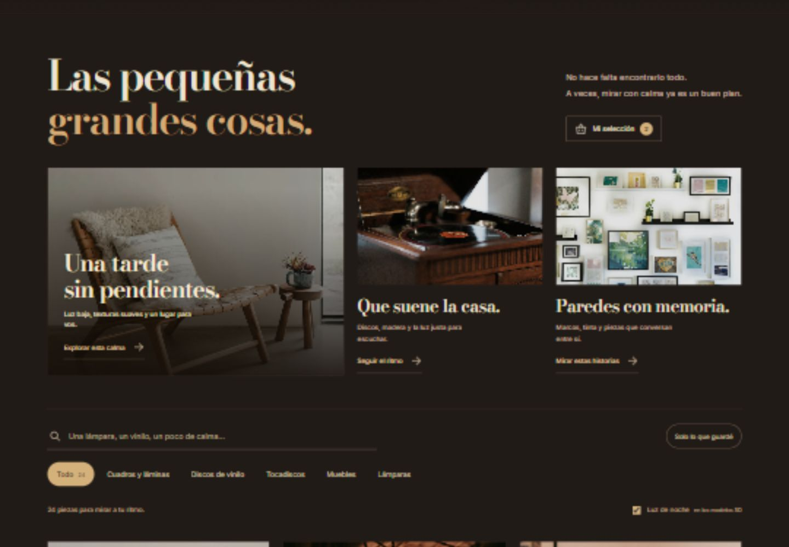

# CASA GROOVE

**Un poco de luz. Un buen disco. Y un lugar que se sienta tuyo.**

Experiencia web de interiores retro creada por [Chriss-DW](https://github.com/Chriss-DW). Una colección para explorar materiales, objetos y música con calma, acompañada de una sala 3D que podés personalizar.



## Explorar

- **24 fotografías reales de inspiración:** seis lámparas, cinco cuadros y láminas, cinco muebles, cuatro vinilos y cuatro tocadiscos.
- Búsqueda, filtros por categoría y tres recorridos editoriales: calma, escucha e historias.
- Recomendaciones con una explicación específica para cada pareja de piezas.
- **Mi selección:** guardar y quitar piezas, escribir una nota, vaciar y deshacer. La selección permanece en este navegador.
- Descarga de la selección como un archivo HTML con las fotografías y los créditos incluidos, utilizable sin conexión.
- Seis vistas ilustrativas en 3D, dos lámparas con interruptor y luz de noche para los modelos.
- Tres ambientes musicales originales con reproducción voluntaria y volumen.
- Sala 3D con controles de paredes, tapizado, alfombra, cuadros, iluminación y cámara.

El catálogo acompaña la inspiración sin precios ni procesos de compra. La selección es local; los ajustes de la sala siguen siendo temporales.

## Ejecutar localmente

Se requiere **Node.js 22 o superior**. No hay paquetes que instalar.

```bash
git clone https://github.com/Chriss-DW/casa-groove.git
cd casa-groove
node scripts/preview.mjs
```

Abrí [127.0.0.1:5084](http://127.0.0.1:5084). La página utiliza módulos ES y debe servirse por HTTP.

## Comprobar y editar

```bash
node --test scripts/selection.test.mjs
node scripts/check-site.mjs
node scripts/build-catalog.mjs
```

El contenido editorial se mantiene en `scripts/catalog-content.mjs`. El generador combina ese contenido con los créditos fotográficos y actualiza el catálogo estático. El estado de la selección tiene un esquema versionado y un único módulo de persistencia.

## Estructura

```text
dist/               Página y recursos listos para servir
  assets/           Fotografías, fuentes y dependencias con sus licencias
  state/            Validación y persistencia de Mi selección
scripts/            Vista previa, generador y comprobaciones
docs/               Diseño, procedencia, verificación y evolución
```

## Diseño y tecnología

HTML semántico, CSS y JavaScript modular. Three.js construye los objetos y la sala; Web Audio sintetiza la música. Los recursos se sirven localmente. El catálogo fotográfico y la selección funcionan independientemente de la inicialización de WebGL.

La identidad combina nogal oscuro, crema y latón, con Bodoni Moda, Inter y la marca en Shrikhand. Se mantienen controles por teclado, foco visible y preferencias de movimiento reducido. [Decisiones de diseño](docs/diseno.md).

## Procedencia y alcance

Las fotografías reales conservan créditos de Unsplash. Los nombres son editoriales y los modelos 3D son ilustrativos; no reproducen productos comerciales. La portada es una imagen conceptual generada con IA, documentada por separado.

[Créditos y licencias](docs/ASSETS.md) · [Verificación](docs/verificacion.md) · [Historial del proyecto](docs/evolucion.md) · [Cómo contribuir](CONTRIBUTING.md)

La [demo alojada](https://casa-groove-chriss.gardensky19.chatgpt.site/) se actualiza por separado; puede ir detrás del código disponible en este repositorio. Las funciones propuestas para una sala generativa todavía no forman parte de esta versión.
